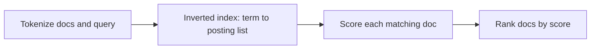

# Session 1: Lexical Search

Lexical search finds documents by matching exact words. It does not know what words mean. It counts words, and it ranks documents by those counts.

This session builds lexical search from scratch. You will write a tokenizer, an inverted index, TF-IDF scoring, and BM25 scoring. You will test each part against numbers you can check by hand.

## The running example

Every session in this course uses the same three docs. Keep them in mind. Nothing changes later.

- Doc 0: "How to reset your password"
- Doc 1: "VPN setup for remote work"
- Doc 2: "How to change your password"

Two queries go with them.

- Query A: "reset password". It shares exact words with Doc 0 and Doc 2.
- Query B: "forgot my login". It means the same thing as Doc 0 and Doc 2, and it shares no useful words with them. Lexical search fails on Query B. That failure is the reason later sessions exist.

After tokenization, the vocab has 11 words:

`how, to, reset, your, password, vpn, setup, for, remote, work, change`

Each doc has 5 tokens. That keeps the math short.

## What lexical search is

A user types a query. The system returns docs in ranked order. Lexical search ranks by word overlap. A doc that shares a rare query word ranks above a doc that shares only a common query word. A doc that shares no query word scores zero.

Lexical search has three limits. First, it misses synonyms. "forgot my login" and "reset your password" mean almost the same thing, but they share no word. Second, it misses word forms. "reset" and "resetting" are different tokens here. Third, it can be fooled by repetition. A doc that repeats one word many times can outrank a better doc. BM25 fixes the third limit. It does not fix the first two.

## Step 1: Tokenization

Tokenization turns text into a list of tokens. A token is one word, in lowercase.

The tokenizer in `src/session01_lexical/tokenizer.py` does three things:

1. Lowercase the text. "How" becomes "how".
2. Split on non-letters. Spaces and punctuation mark word breaks. Numbers are dropped.
3. Drop stopwords listed in `STOPWORDS`.

The stopword list is explicit, and it matters for the numbers in this session. `STOPWORDS` holds only words that never appear in the three docs: `a, an, the, is, are, and, or, of, in, on`. None of the 11 vocab words is dropped. That is why the vocab stays at 11 words, and why each doc still has 5 tokens.

Tokenized docs:

- Doc 0: `[how, to, reset, your, password]`
- Doc 1: `[vpn, setup, for, remote, work]`
- Doc 2: `[how, to, change, your, password]`

Query A tokenizes to `[reset, password]`. Query B tokenizes to `[forgot, my, login]`. None of those three words appears in any doc. That is the whole story of Query B under lexical search.

Code: `src/session01_lexical/tokenizer.py`, function `tokenize`.

## Step 2: The inverted index

A search system cannot scan every doc for every query. It builds an inverted index once, then looks up query words in it.

An inverted index maps each term to a posting list. A posting list holds one entry per doc that contains the term. Each entry is a pair: doc id, and count of the term in that doc.

Code: `src/session01_lexical/inverted_index.py`, functions `build_index` and `lookup`.

The index for the three docs:

| Term | Posting list |
| --- | --- |
| how | [(0, 1), (2, 1)] |
| to | [(0, 1), (2, 1)] |
| reset | [(0, 1)] |
| your | [(0, 1), (2, 1)] |
| password | [(0, 1), (2, 1)] |
| vpn | [(1, 1)] |
| setup | [(1, 1)] |
| for | [(1, 1)] |
| remote | [(1, 1)] |
| work | [(1, 1)] |
| change | [(2, 1)] |

To answer Query A, the system looks up `reset` and `password`, and it only scores Doc 0 and Doc 2. Doc 1 never enters the work. That is the point of the index. Lookup is fast, and scoring touches only docs that share at least one query word.



## Step 3: TF-IDF

TF-IDF gives each term in each doc a weight. The weight has two parts.

### Term frequency (TF)

TF asks: how much of this doc is this term? It is the count of the term in the doc, divided by the doc length in tokens.

```
TF = count of term in doc / number of tokens in doc
```

Doc 0 has 5 tokens. `reset` appears once. So TF for `reset` in Doc 0 is 1 / 5 = 0.20. The same holds for `password` in Doc 0, and for `password` in Doc 2. Every term in every doc here has TF 0.20, because every term appears once and every doc has 5 tokens.

### Inverse document frequency (IDF)

IDF asks: how rare is this term across the whole set of docs? A rare term tells you more than a common term. The formula used here uses log base 10.

```
IDF = log10(N / DF)
```

N is the number of docs. DF is the document frequency: the number of docs that contain the term.

- `reset`: DF is 1, it appears only in Doc 0. IDF = log10(3 / 1) = 0.48.
- `password`: DF is 2, it appears in Doc 0 and Doc 2. IDF = log10(3 / 2) = 0.18.
- `how`: DF is 2, same as `password`. IDF = 0.18.

A term in all three docs would have IDF log10(3 / 3) = 0. It would add nothing to any score. That is correct. A word in every doc cannot tell docs apart.

### TF-IDF weight and score

The weight is TF times IDF. The score of a doc for a query is the sum of the weights of the query terms in that doc.

```
TF-IDF = TF * IDF
score(doc, query) = sum of TF-IDF over query terms in the doc
```

Worked numbers for the query terms:

| Term | TF | DF | IDF | TF-IDF |
| --- | --- | --- | --- | --- |
| reset, Doc 0 | 0.20 | 1 | 0.48 | 0.096 |
| password, Doc 0 | 0.20 | 2 | 0.18 | 0.035 |
| password, Doc 2 | 0.20 | 2 | 0.18 | 0.035 |
| how, Doc 0 or Doc 2 | 0.20 | 2 | 0.18 | 0.035 |

Query A scores, TF-IDF:

- Doc 0: 0.096 + 0.035 = 0.131
- Doc 2: 0.035
- Doc 1: 0

Doc 0 ranks first. It matches the rare word `reset` and the common word `password`. Doc 2 matches only `password`. Doc 1 matches nothing.

Code: `src/session01_lexical/tfidf.py`, functions `term_frequency`, `inverse_document_frequency`, `tfidf`, and `score`.

A note on rounding: the values above are rounded to two or three places. The code keeps full precision, and the tests allow a 2 percent relative tolerance. So 0.0954 rounds to 0.096, and 0.0352 rounds to 0.035.

## Step 4: BM25

BM25 is the standard lexical ranking formula. It keeps the TF-IDF idea, a rare term counts more, and it fixes two TF-IDF problems.

First, TF-IDF grows without limit as a term repeats. A doc that says `password` 100 times scores about 100 times more than a doc that says it once. That is wrong. One mention already shows the topic. The tenth mention adds little. BM25 caps the gain. This is called saturation.

Second, TF-IDF as written here does not adjust for doc length. A long doc can collect matches just by being long. BM25 adjusts for length. A match in a short doc counts more than the same match in a long doc.

### The BM25 formula

For one query term in one doc:

```
score(term, doc) = IDF(term) * (f * (k1 + 1)) / (f + k1 * (1 - b + b * len / avg_len))
```

- `f` is the count of the term in the doc.
- `len` is the doc length in tokens.
- `avg_len` is the mean doc length across the set.
- `k1` controls saturation. This session uses k1 = 1.2.
- `b` controls length normalization. This session uses b = 0.75. b = 0 turns length normalization off. b = 1 applies it in full.

The doc score is the sum over query terms, as in TF-IDF.

### BM25 IDF

BM25 uses a different IDF from TF-IDF. It uses the natural log, and it adds 0.5 to the counts. The 0.5 keeps the value finite when a term appears in every doc or in no doc.

```
IDF = ln((N - DF + 0.5) / (DF + 0.5) + 1)
```

Worked numbers, N = 3:

- `reset`, DF 1: ln((3 - 1 + 0.5) / (1 + 0.5) + 1) = ln(2.67) = 0.98
- `password`, DF 2: ln((3 - 2 + 0.5) / (2 + 0.5) + 1) = ln(1.60) = 0.47

### Saturation, step by step

Set doc length equal to average length, so the length part is 1. Then the TF part is `f * 2.20 / (f + 1.2)`. As `f` grows, this part approaches k1 + 1 = 2.20, and it never passes it.

| f | TF part |
| --- | --- |
| 1 | 1.00 |
| 2 | 1.37 |
| 10 | 1.96 |
| 100 | 2.17 |

Check the last row: 100 * 2.20 / (100 + 1.2) = 220 / 101.2 = 2.17. The cap is 2.20. Going from 10 mentions to 100 mentions lifts the factor only from 1.96 to 2.17. That is the whole point. Repetition stops paying.

### Length normalization, step by step

Take one mention, f = 1, with average doc length 10. Compare a short doc of 5 words and a long doc of 20 words.

- Short doc, len 5: 2.20 / (1 + 1.2 * (0.25 + 0.75 * 5 / 10)) = 2.20 / 1.75 = 1.26
- Long doc, len 20: 2.20 / (1 + 1.2 * (0.25 + 0.75 * 20 / 10)) = 2.20 / 3.10 = 0.71

The same single mention scores 1.26 in the short doc and 0.71 in the long doc. The short doc is more focused on that term, so the match counts more.

### Worked example: Query A with BM25

All three docs have length 5, and the average length is 5. So the length part is 1 for every doc, and the TF part is 1.00 for each term that appears once.

- Doc 0: `reset` 0.98 * 1.00 = 0.98, plus `password` 0.47 * 1.00 = 0.47. Total 1.45 (1.451 before rounding).
- Doc 2: `password` 0.47 * 1.00 = 0.47.
- Doc 1: 0.

Ranking matches TF-IDF here: Doc 0 first, Doc 2 second, Doc 1 last. The scores differ, and the gap between Doc 0 and Doc 2 is wider under BM25, because `reset` is rare and BM25 gives it a larger IDF.

Code: `src/session01_lexical/bm25.py`, functions `inverse_document_frequency`, `term_frequency_component`, `saturation_factor`, and `score`.

## What to run

From the repo root:

```
python -m pytest tests/test_session01_lexical.py -q
python examples/session01_demo.py
```

The demo prints Query A scores under TF-IDF and BM25. The tests reproduce every number in this article: tokenizer output, posting lists, TF-IDF scores, BM25 scores, and saturation values.

## Where lexical search breaks

Query B, "forgot my login", scores zero for every doc under both TF-IDF and BM25. No doc shares a word with it. The user still wants Doc 0 and Doc 2. Lexical search cannot see that "forgot my login" and "reset your password" point at the same need. Session 2 fixes this with dense search, which matches meaning instead of words. BM25 stays in the system as the lexical half of hybrid search in Session 3.

## Self-check questions

1. Query A is "reset password". Why does Doc 0 score higher than Doc 2 under TF-IDF?
   Answer: Doc 0 matches both query terms, Doc 2 matches only `password`. Doc 0 gets 0.096 for `reset` plus 0.035 for `password`, total 0.131. Doc 2 gets only 0.035 for `password`. `reset` also carries more weight than `password`, because it appears in one doc instead of two, so its IDF is 0.48 against 0.18.

2. A doc repeats `password` 100 times. Under BM25, with doc length equal to average length, how much does the TF part grow compared with 1 mention, and what is the cap?
   Answer: With 1 mention the TF part is 1.00. With 100 mentions it is 2.17. It grows by a factor of about 2.17, not 100. The cap is k1 + 1 = 2.20. That cap is saturation: extra mentions add less and less.

3. Two docs each mention a query term once. One doc has 5 words, the other has 20 words, and the average doc length is 10. Which doc scores higher under BM25, and by how much for the TF part?
   Answer: The short doc scores higher. Its TF part is 1.26, against 0.71 for the long doc. Length normalization rewards the focused match in the short doc and discounts the same match in the long doc.

## References

- Salton, G., Wong, A., and Yang, C. S. (1975). A Vector Space Model for Automatic Indexing. *Communications of the ACM*, 18(11), 613-620. https://doi.org/10.1145/361219.361220
- Sparck Jones, K. (1972). A Statistical Interpretation of Term Specificity and Its Application in Retrieval. *Journal of Documentation*, 28(1), 11-21. https://doi.org/10.1108/eb026526
- Robertson, S., and Zaragoza, H. (2009). The Probabilistic Relevance Framework: BM25 and Beyond. *Foundations and Trends in Information Retrieval*, 3(4), 333-389. https://doi.org/10.1561/1500000019
