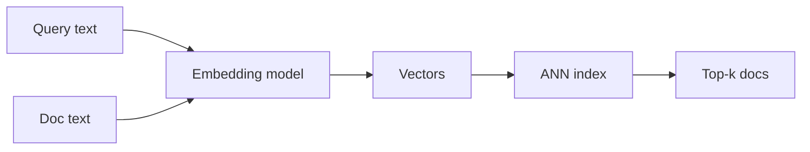

# Session 2: Dense Search

Dense search finds meaning. Lexical search, from Session 1, finds exact
words. That works when the query and the doc share words. It fails when
they do not.

## The running example

We use the same 3 docs in every session:

- Doc 0: "How to reset your password"
- Doc 1: "VPN setup for remote work"
- Doc 2: "How to change your password"

Query B is "forgot my login". It means the same as Doc 0 and Doc 2, and
it shares no useful words with them. "Forgot" is not "reset". "Login"
is not "password". A word match scores Query B near zero against all
3 docs. A meaning match should rank Doc 0 first, then Doc 2, then
Doc 1 far behind. This session shows how.

## What an embedding is

An embedding is a list of numbers that stands for the meaning of a
piece of text. A model reads the text and returns the list. Texts
with close meanings get lists that point in close directions. Texts
with different meanings get lists that point in different directions.

A real embedding has hundreds of numbers. Common sizes are 384, 768,
or 1536 numbers per text. We use 3 numbers per text in this session,
so every step can be checked by hand. The 3 numbers below are toy
vectors for teaching. They are not outputs of a real embedding model.
A real model would never return vectors this tidy. The toy vectors
are built so Doc 0 and Doc 2 sit near each other, Doc 1 sits far
away, and Query B sits next to Doc 0 and Doc 2.

| Text | Toy vector |
| --- | --- |
| Doc 0: "How to reset your password" | [0.90, 0.10, 0.20] |
| Doc 1: "VPN setup for remote work" | [0.10, 0.90, 0.10] |
| Doc 2: "How to change your password" | [0.85, 0.15, 0.25] |
| Query B: "forgot my login" | [0.88, 0.12, 0.20] |

Think of each number as one direction of meaning. The first number
is high for password talk. The second number is high for VPN and
remote work talk. The third number is small in all of these. A real
model has no labels like that on its numbers. The numbers only gain
meaning from training. The toy labels help you read the example, and
nothing else.

How does a model learn these numbers? Sentence-BERT is one clear
example. It starts from BERT, runs two copies of the same network side
by side on pairs of sentences, and trains the network so that
sentences with the same meaning end up close together. After training,
each sentence goes through the model once, and the result is one
fixed-size vector. Comparing two sentences is then just comparing
two vectors. See the paper reference at the end of this article.

## Dot product

The dot product multiplies matching numbers and adds the results.
For vectors a and b with n numbers:

```text
dot(a, b) = a1*b1 + a2*b2 + ... + an*bn
```

Worked steps for Query B, written as q = [0.88, 0.12, 0.20]:

```text
q . Doc 0 = 0.88*0.90 + 0.12*0.10 + 0.20*0.20
         = 0.792 + 0.012 + 0.040
         = 0.844

q . Doc 2 = 0.88*0.85 + 0.12*0.15 + 0.20*0.25
         = 0.748 + 0.018 + 0.050
         = 0.816

q . Doc 1 = 0.88*0.10 + 0.12*0.90 + 0.20*0.10
         = 0.088 + 0.108 + 0.020
         = 0.216
```

The dot product already ranks Doc 0 first and Doc 2 second. But the
dot product mixes two things: direction and length. A long vector
scores high against everything, even when its direction is only a
rough match. That is why search rarely uses the raw dot product
unless the vectors are first made the same length.

## Norm: the length of a vector

The norm, also called the L2 norm, is the length of a vector:

```text
norm(a) = sqrt(a1^2 + a2^2 + ... + an^2)
```

Worked steps:

```text
norm(q)     = sqrt(0.88^2 + 0.12^2 + 0.20^2)
            = sqrt(0.7744 + 0.0144 + 0.0400)
            = sqrt(0.8288) = 0.9104

norm(Doc 0) = sqrt(0.90^2 + 0.10^2 + 0.20^2)
            = sqrt(0.81 + 0.01 + 0.04)
            = sqrt(0.86) = 0.9274

norm(Doc 2) = sqrt(0.85^2 + 0.15^2 + 0.25^2)
            = sqrt(0.7225 + 0.0225 + 0.0625)
            = sqrt(0.8075) = 0.8986

norm(Doc 1) = sqrt(0.10^2 + 0.90^2 + 0.10^2)
            = sqrt(0.01 + 0.81 + 0.01)
            = sqrt(0.83) = 0.9110
```

All four lengths are close to 0.9, so length barely matters in this
toy example. In real data it matters a lot, and that is the point
of the next section.

## Cosine similarity

Cosine similarity is the dot product divided by both lengths:

```text
cosine(a, b) = dot(a, b) / (norm(a) * norm(b))
```

It measures direction only. Length cancels out. The result runs from
-1 to 1. A value of 1 means the vectors point in exactly the same
direction. A value of 0 means they point at right angles, with no
shared direction. A value of -1 means they point in opposite
directions.

Worked steps for Query B:

```text
cosine(q, Doc 0) = 0.844 / (0.9104 * 0.9274)
                 = 0.844 / 0.8443
                 = 0.9997, about 1.00

cosine(q, Doc 2) = 0.816 / (0.9104 * 0.8986)
                 = 0.816 / 0.8181
                 = 0.9975, about 0.99

cosine(q, Doc 1) = 0.216 / (0.9104 * 0.9110)
                 = 0.216 / 0.8294
                 = 0.2604, about 0.26
```

Result: Doc 0 first (about 1.00), Doc 2 second (about 0.99), Doc 1
last (about 0.26). That is the ranking we wanted. Query B finds the
password docs even though it shares no useful words with them.

Note on rounding: the brief for this session rounded these three
values to about 1.00, about 0.99, and about 0.28. The step by step
math above gives 0.9997, 0.9975, and 0.2604. The Doc 1 value is
about 0.26, not about 0.28. The ranking is the same either way, and
the tests check the values the steps give: 1.00, 0.99, and 0.26,
each within 0.01.

## Euclidean distance

Euclidean distance is the straight line distance between two points:

```text
euclidean(a, b) = sqrt((a1-b1)^2 + (a2-b2)^2 + ... + (an-bn)^2)
```

Smaller is closer. Worked steps for Query B:

```text
euclidean(q, Doc 0) = sqrt((0.88-0.90)^2 + (0.12-0.10)^2 + (0.20-0.20)^2)
                    = sqrt(0.0004 + 0.0004 + 0.0000)
                    = sqrt(0.0008) = 0.0283

euclidean(q, Doc 2) = sqrt((0.88-0.85)^2 + (0.12-0.15)^2 + (0.20-0.25)^2)
                    = sqrt(0.0009 + 0.0009 + 0.0025)
                    = sqrt(0.0043) = 0.0656

euclidean(q, Doc 1) = sqrt((0.88-0.10)^2 + (0.12-0.90)^2 + (0.20-0.10)^2)
                    = sqrt(0.6084 + 0.6084 + 0.0100)
                    = sqrt(1.2268) = 1.1076
```

Euclidean distance gives the same ranking here: Doc 0, then Doc 2,
then Doc 1. That happens because all four toy vectors have nearly
the same length. When lengths differ, the two measures can disagree.
Cosine ignores length. Euclidean does not. A doc with a long vector
can sit far from the query in Euclidean distance even when it points
the right way.

## Cosine vs dot product vs Euclidean distance

| Measure | What it compares | Range | Best when |
| --- | --- | --- | --- |
| Cosine similarity | Direction only | -1 to 1, higher is closer | Text search, where length should not matter |
| Dot product | Direction and length together | No fixed range, higher is closer | Vectors are already the same length, so it equals cosine times a constant |
| Euclidean distance | Straight line distance | 0 and up, lower is closer | Length carries meaning, or vectors are points in space |

One practical rule covers most text search: normalize each vector to
length 1 first, then use the dot product. When every vector has
length 1, the dot product equals the cosine similarity, and the dot
product is cheaper to compute. That is why many vector indexes offer
an inner product mode and tell you to normalize first.

A second rule: never mix measures without saying which one you used.
A score of 0.99 under cosine and a score of 0.99 under dot product
mean different things. Fusion in Session 3 depends on knowing which
score came from where.

## Exact KNN: brute force

KNN means k nearest neighbors. Given a query, find the k docs
closest to it. Brute force is the exact way to do it: score the
query against every doc, sort the scores, keep the top k. The code
is in `src/session02_dense/knn.py`, function `brute_force_knn`.
For Query B with k = 2 it returns Doc 0 (0.9997) then Doc 2 (0.9975).

Brute force is exact, and its cost is easy to see. One query costs
one score per doc, and each score touches every number in the vector.
With N docs and d numbers per vector, one query costs about N times
d steps. Double the docs, double the time. At 3 docs that is nothing.
At 1 million docs with 768 numbers each, one query is about 768
million multiply steps. That can still run, but it gets slow when
many queries arrive at once, and it gets worse as the collection
grows. Exact search does not scale by hoping. It needs a shortcut,
and the shortcut is to skip most of the docs.

## ANN: trading recall for speed

ANN means approximate nearest neighbor search. Instead of scoring
every doc, ANN skips the docs that are probably far away, and scores
only a shortlist. It is faster, and it can miss a true neighbor.
That miss is the trade, and it has a name: recall.

Recall at k is the share of the true top k that the approximate
search found. If exact search says the top 10 are docs A through J,
and ANN returns 9 of them, recall at 10 is 0.9. A recall of 1.0
means nothing was missed. A recall of 0.9 means 1 doc in 10 was
missed. Every ANN method has a knob that trades recall for speed.
Turn the knob one way and the search checks more docs, recall rises,
and time rises. Turn it the other way and the search checks fewer
docs, recall falls, and time falls. There is no free setting. The
right setting depends on what a miss costs in your product.

Three ANN ideas cover most real systems: HNSW, IVF, and PQ. They
solve different parts of the problem. HNSW and IVF cut down how many
docs get scored. PQ cuts down how much memory each vector takes.
They are often combined: IVF picks which docs to score, PQ stores
the vectors in small form, and HNSW is used instead of IVF when
speed matters more than memory.

## HNSW: a graph with layers

HNSW stands for Hierarchical Navigable Small World. It builds a
graph. Each doc is a node. Each node links to a few of its nearest
neighbors. Search is a walk on the graph: start at an entry node,
step to the neighbor closest to the query, repeat until no neighbor
is closer. That is greedy search, and it works because neighbors of
a close doc tend to be close docs too.

One flat graph has a weakness. A greedy walk can get stuck in a
local pocket, a group of docs that are close to each other but far
from the true best doc. HNSW fixes this with layers. Picture a stack
of graphs. The bottom layer holds every doc, with short links to
close neighbors. Each layer above holds fewer docs, with longer
links that jump further. The top layer holds only a few docs, with
the longest jumps. Search starts at the top, takes long jumps to
get near the right area, then drops to the next layer and refines,
and keeps dropping until it reaches the bottom layer, where it
finishes the search up close. The layers act like a map with zoom
levels: country, then city, then street.

Three knobs matter:

- M: how many links each node keeps. More links mean a better
  connected graph and higher recall, at the cost of more memory
  and slower build time. A common starting value is 16.
- ef_construction: how hard the build works to find good neighbors
  for each new node. Higher means a better graph and a slower build.
- ef_search: how many candidates the search keeps while walking.
  This is the recall knob at query time. A bigger ef_search checks
  more candidates, finds more true neighbors, and takes longer.
  Raise ef_search when recall matters more than speed.

The toy in `src/session02_dense/ann_toy.py` is a one layer version
of this idea: a small graph where each node links to its 2 nearest
neighbors, searched by a greedy walk from Doc 0. It finds Doc 0
then Doc 2 for Query B, the same top 2 as exact search. It is a
teaching toy, not production HNSW. Real HNSW has layers, a smarter
neighbor rule, and ef_search. The toy has none of those, and it
only works because the graph is tiny.

## IVF: clusters, then search a few

IVF stands for inverted file index. It groups the docs into
clusters first, then searches only the clusters nearest the query.

Build time: run k-means clustering on the vectors, with nlist
clusters. Each doc goes into the cluster whose center is closest
to it. A common choice is nlist near the square root of N, the
number of docs. With 1 million docs, that is about 1,000 clusters.

Query time: find the nprobe clusters whose centers are closest to
the query, and score only the docs inside those clusters. The rest
are skipped. nprobe is the recall knob here. With nprobe = 1, the
search looks in one cluster, which is fast and can miss docs in
the next cluster over. With nprobe = 10, it looks in 10 clusters,
which is slower and misses less. With nprobe = nlist, it scores
everything, and IVF becomes brute force.

IVF fits when the data has clear groups. It fits less well when the
query sits on a border between clusters, because the true neighbors
may sit in a cluster the search never opens. Raising nprobe is the
fix, and the cost is time.

## PQ: compression

PQ stands for product quantization. It shrinks each vector so that
more vectors fit in memory. The idea is simple: split a vector into
small parts, and replace each part with a short code that names the
closest entry in a small table learned from the data.

Worked example, with the assumptions stated. Assume 768 numbers
per vector, stored as float32, which is 4 bytes per number. One
full vector takes 768 times 4 = 3072 bytes. Split the vector into
96 parts of 8 numbers each. For each part, learn 256 typical
patterns from the data, and store 1 byte per part, the code of the
closest pattern. One compressed vector takes 96 times 1 = 96 bytes.
That is 3072 / 96 = 32 times smaller. The code tables add a little
extra memory, about 96 parts times 256 patterns times 8 numbers
times 4 bytes, which is about 0.8 MB in total, small next to the
vectors themselves.

For 1 million vectors, the compressed form takes 96 bytes times
1,000,000 = 96,000,000 bytes, about 96 MB in decimal units, or
about 91.6 MiB. The full form would take about 3072 MB. That is
the point of PQ: a collection that does not fit in memory can fit
after compression.

Compression costs accuracy. A compressed vector is an estimate of
the real vector, so its scores are estimates too. The usual fix is
two stages: use PQ scores to pick a shortlist, then re-score the
shortlist with full vectors. That keeps most of the speed and most
of the accuracy.

## FAISS vs hnswlib

FAISS and hnswlib are both libraries, not databases. A database
stores docs, runs transactions, and enforces access rules. These
libraries do none of that. They hold vectors in memory and answer
nearest neighbor queries. A vector database wraps a library like
one of these with storage, filtering, and an API.

| | FAISS | hnswlib |
| --- | --- | --- |
| What it is | A toolkit for similarity search, from Meta, with many index types | One algorithm, HNSW, in a small package |
| Index types | Flat (exact), IVF, PQ, HNSW, and combinations such as IVF-PQ | HNSW only |
| GPU | Yes, FAISS has GPU support | No, CPU only |
| Size and setup | Larger, more to learn, more knobs | Small, quick to install, few knobs |
| Best when | You need IVF, PQ, GPU search, or billion scale search | You need fast HNSW search and nothing else |

Pick FAISS when you need its range, for example IVF-PQ for a large
collection on limited memory, or GPU search. Pick hnswlib when HNSW
alone is enough and you want the simplest moving part. Both are
fine choices for the small scale in this course. Neither one is
needed to run the toy code here, which uses the standard library
only.

## The pipeline



Read it left to right. Doc text goes through the embedding model
once, at index time, and the vectors go into the ANN index. Query
text goes through the same model at query time, and the query vector
goes into the same index. The index returns the top k docs. The
model must be the same on both sides. A query vector from one model
cannot be compared with doc vectors from another model.

## What the code does

- `src/session02_dense/similarity.py`: `dot`, `norm`, `cosine`,
  and `euclidean`, using the standard library `math` module only.
- `src/session02_dense/knn.py`: `brute_force_knn`, exact top-k by
  cosine similarity. It scores every doc and sorts.
- `src/session02_dense/ann_toy.py`: `ToyGraph` and
  `toy_ann_search`, a small greedy graph walk over the 3 toy docs
  plus 3 synthetic points. A teaching toy, not production HNSW.
  It returns the same top 2 as exact search for Query B.
- `src/session02_dense/__init__.py`: exports the public names,
  including the toy vectors `TOY_DOCS` and the query `QUERY_B`.
- `tests/test_session02_dense.py`: pytest tests that reproduce
  every number in this article: the dot products, the norms, the
  cosines, the Euclidean distances, the exact KNN ranking, and the
  toy ANN ranking.
- `examples/session02_demo.py`: prints the Query B ranking from
  exact search and from the toy ANN search. Run it with
  `python examples/session02_demo.py` from the repo root.

## Papers

- Malkov and Yashunin, 2018. The HNSW paper, on graph search with
  layers for approximate nearest neighbors. First posted on arXiv
  in 2016, revised in 2018, later published in IEEE Transactions on
  Pattern Analysis and Machine Intelligence, volume 42, number 4,
  2020. Link: https://arxiv.org/abs/1603.09320
- Jeff Johnson, Matthijs Douze, and Herve Jegou, 2019.
  "Billion-scale similarity search with GPUs". IEEE Transactions on
  Big Data, volume 7, number 3, pages 535-547. The FAISS paper.
  Link: https://arxiv.org/abs/1702.08734
- Nils Reimers and Iryna Gurevych, 2019. "Sentence-BERT: Sentence
  Embeddings using Siamese BERT-Networks". Proceedings of EMNLP-IJCNLP
  2019. Link: https://arxiv.org/abs/1908.10084

## Self-check

1. Query B has cosine about 1.00 with Doc 0 and about 0.26 with
   Doc 1. What does that tell you about the directions of the three
   vectors?
   Answer: Query B points almost the same way as Doc 0, and in a
   quite different direction from Doc 1. Doc 0 and Doc 2 point
   almost the same way as each other, which is why both score near
   1.00. Cosine measures direction, so these scores say the query
   means nearly the same as the password docs and little like the
   VPN doc.

2. You normalize all vectors to length 1, then rank by dot product.
   Why does this give the same ranking as cosine similarity?
   Answer: cosine is the dot product divided by both lengths. When
   every length is 1, dividing by 1 changes nothing, so the dot
   product equals the cosine. The ranking is the same, and the dot
   product is cheaper to compute.

3. An ANN index returns 8 of the true top 10 docs. What is recall
   at 10, and what knob would you turn to raise it on an HNSW index?
   Answer: recall at 10 is 8 / 10 = 0.8. On HNSW, raise ef_search,
   which keeps more candidates during the walk. Recall should rise,
   and each query should take longer. On an IVF index the matching
   knob is nprobe, the number of clusters searched.
