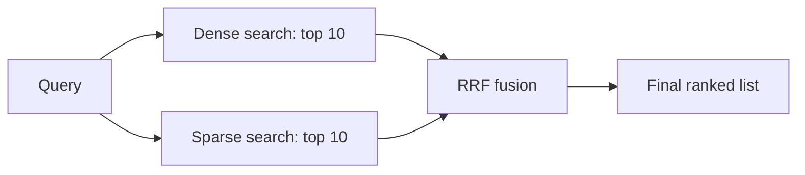

# Session 3: Hybrid Search

## What this session covers

One search method is not enough. Dense search understands meaning but misses exact codes. Sparse search matches exact words but misses synonyms. This session puts the two together, scores the mix, and measures the result.

You will learn SPLADE, a learned sparse model that fixes the worst sparse failures. You will learn two ways to fuse two ranked lists: score fusion and rank fusion. You will learn Reciprocal Rank Fusion (RRF), the short formula that most hybrid systems use. You will learn how a store like Qdrant holds both vector types in one collection. You will finish with the five evaluation numbers that tell you if a change helped: Precision at K, Recall at K, MRR, NDCG, and MAP at K.

## The running example

Use these three docs and two queries in every section below.

- Doc 0: "How to reset your password"
- Doc 1: "VPN setup for remote work"
- Doc 2: "How to change your password"

- Query A: "reset password" (exact words from Doc 0)
- Query B: "forgot my login" (same meaning as Doc 0, no shared words)

A second example comes from the Colab notebook. The docs are bathroom exhaust fans from the ESCI dataset. The query is "quiet bathroom exhaust fan", and a harder query is the exact model code "revent 80 cfm", which should match the Panasonic FV-20VQ3 listing. Keep this example in mind when exact codes come up.

## Why dense search fails on exact codes

Dense search turns text into a vector of numbers. Two texts with close meanings get close vectors. That is its strength and its weak spot.

Take the query "revent 80 cfm". A dense model reads it as a request for a quiet fan with a certain airflow. It may rank a popular quiet fan first, even if that fan is not a Revent and not 80 CFM. The model code "revent" and the number "80" are small details inside a long vector. They get smoothed out. The exact match is lost in the average.

The same thing happens with error codes, part numbers, version strings, and names. A dense model knows what the words mean. It does not keep a sharp record of which exact tokens were present. If the answer depends on one exact token, dense search alone is the wrong tool.

## Why sparse search fails on synonyms

Sparse search, such as BM25, matches words. A doc scores only when it shares words with the query. That is exact and easy to explain. It also breaks the moment the user picks different words.

Query B is "forgot my login". Doc 0 is "How to reset your password". They mean the same thing. They share no words. BM25 gives Doc 0 a score of 0. The best doc in the set is invisible to the search.

The same failure shows up with "car" versus "automobile", "fix" versus "repair", and "quiet" versus "low noise". Sparse search has no idea that two different words can mean the same thing. It can only count shared tokens.

So each method has one blind spot, and the blind spots are opposites. Dense search misses exact tokens. Sparse search misses shared meaning. Hybrid search runs both and fuses the answers.

## SPLADE: sparse search that learned synonyms

SPLADE fixes the sparse blind spot without giving up exact matching. The name stands for Sparse Lexical And Expansion model. It was introduced by Formal, Piwowarski, and Clinchant in 2021 (see the papers section at the end).

### What SPLADE does

SPLADE runs a BERT model over a doc. But instead of taking one pooled vector, it uses the masked language model head of BERT. That head predicts a score for every term in the BERT vocabulary, about 30,000 WordPiece terms, for each word in the doc. Then it pools those scores across the doc.

The result is a sparse vector. It looks like a BM25 vector: one weight per term, most weights zero. But the weights are learned, not counted. And the vector can hold terms that never appeared in the doc. That is term expansion.

Doc 0, "How to reset your password", gets a SPLADE vector like this in the Colab notebook example:

- reset: 2.1, password: 1.8, forgot: 1.2, login: 1.1, change: 0.9, credentials: 0.7

Compare that with the plain BM25 vector for the same doc:

- reset: 0.096, password: 0.035

BM25 has two terms. SPLADE has six. The extra four (forgot, login, change, credentials) are the expansion. The model learned that a doc about resetting a password is also about forgetting a login and changing credentials.

Now score Query B, "forgot my login", against Doc 0. BM25 scores 0, because neither word appears in the doc. SPLADE scores about 6.74. This is the notebook example, with SPLADE weights as given. The query is expanded the same way as the doc, and the score is the dot product of the two expanded vectors. The exact query-side weights are fixed toy values in the code for this session (see `src/session03_hybrid/splade_toy.py`), and the arithmetic is shown in that file. The point stands either way: expansion turns a zero into a match.

### The weight formula

For each term in the vocabulary, SPLADE computes a weight like this:

```
w = max over input tokens of log(1 + ReLU(logit))
```

Read it piece by piece:

- `logit` is the raw score the BERT head gives to a vocabulary term at one input word.
- `ReLU` drops every negative score to zero. A term the model dislikes gets no weight.
- `log(1 + x)` shrinks large scores. A term with a logit of 10 does not beat a term with a logit of 5 by a factor of two. The log keeps one strong term from taking over the whole vector.
- `max over input tokens` takes the best score for that term across all words in the doc. If any word in the doc strongly suggests the term "forgot", the doc gets weight for "forgot".

Most vocabulary terms end up at zero. The vector stays sparse, so it still runs on a plain inverted index, the same index BM25 uses.

### The FLOPS regularizer, in plain words

A sparse vector is only cheap if it stays sparse. If SPLADE gave weight to thousands of terms per doc, the index would slow to a crawl. So training adds a penalty called the FLOPS regularizer.

FLOPS here means floating point operations, the arithmetic the index does at search time. The regularizer estimates that cost from the weights: roughly, how many terms are nonzero and how large they are. The bigger the estimate, the bigger the penalty. The model learns to spend its nonzero weights only where they earn their keep. Terms that add little get pushed to zero.

In short: the regularizer is a budget. It tells the model that every extra term costs something, so expansion has to pay for itself.

### The training loss, in plain words

Training has two parts.

1. A ranking loss. The model sees a query, a doc that answers it, and a doc that does not. The loss is small when the right doc scores higher than the wrong doc by a clear gap. It is large when the order is wrong or too close. This is the same idea as training a dense retriever: pull good pairs together, push bad pairs apart.
2. The FLOPS penalty, one term for the query vector and one for the doc vector. Each is multiplied by a small weight that sets how much sparsity matters.

Add the two parts and you get the full loss: rank the right doc first, and keep the vectors sparse while you do it.

### What SPLADE is not

SPLADE is not a dense model. Its output is a bag of weighted terms, so it keeps exact matching and it runs on an inverted index. It is also not a real model in the toy code in this repo. The toy uses fixed weights to show the idea. A real SPLADE model needs a trained BERT checkpoint and a training set. Do not mistake the toy numbers for model output.

## Score fusion: normalize, then take a weighted sum

Once you have two scores for each doc, one dense and one sparse, the simplest mix is a weighted sum:

```
fused = w_dense * dense + w_sparse * sparse
```

with the weights adding to 1. A common split is 0.7 dense and 0.3 sparse, which trusts meaning more than exact words. If exact codes matter more in your data, flip the balance.

There is one catch. Dense scores and sparse scores live on different scales. A cosine similarity runs from -1 to 1. A BM25 score can be 0.13 or 12.4. Adding raw scores lets the bigger scale win by accident. So normalize first.

Min-max normalization rescales each list to the range 0 to 1:

```
normalized = (score - min) / (max - min)
```

The best doc in the list becomes 1, the worst becomes 0, and the rest fall in between. Do this separately for the dense list and the sparse list, then take the weighted sum.

### Worked example

After min-max normalization, suppose the scores are:

- Doc 0: dense 0.9, sparse 0.8
- Doc 2: dense 0.6, sparse 0.9
- Doc 1: dense 0.7, sparse 0.2

With weights 0.7 dense and 0.3 sparse:

- Doc 0: 0.7 * 0.9 + 0.3 * 0.8 = 0.63 + 0.24 = 0.87
- Doc 2: 0.7 * 0.6 + 0.3 * 0.9 = 0.42 + 0.27 = 0.69
- Doc 1: 0.7 * 0.7 + 0.3 * 0.2 = 0.49 + 0.06 = 0.55

Final order: Doc 0, Doc 2, Doc 1. Doc 0 wins because it is good on both lists. Doc 2 beats Doc 1 because its strong sparse score makes up for a weaker dense score.

Score fusion is easy to tune: move the weights and the order moves with them. Its weakness is the tuning itself. The right weights depend on the data, and they drift when the data changes. That is why many systems use rank fusion instead.

## Rank fusion: Reciprocal Rank Fusion (RRF)

RRF ignores scores completely. It uses only ranks. That removes the scale problem at a stroke, and it removes the weights too. There is nothing to tune except one constant.

The formula, from Cormack, Clarke, and Buettcher (2009):

```
RRF(d) = sum over each list of 1 / (60 + rank(d))
```

`rank(d)` is the 1-based position of doc `d` in one list. The constant 60 is called `k`. The authors picked 60 by testing values on their data, and 60 stuck as the default. A large `k` flattens the curve, so the gap between rank 1 and rank 2 is small and lower ranks still count for something.

A doc that appears in both lists gets two terms. A doc that appears in only one list gets one term, and the missing list counts as a very low rank. In this session the code uses rank 1000 for a missing doc, so its term is 1 / (60 + 1000) = 1 / 1060.

### Worked example

Take a dense list and a sparse list. A doc at rank 1 in the dense list and rank 3 in the sparse list scores:

```
1 / (60 + 1) + 1 / (60 + 3) = 1/61 + 1/63 = 0.0164 + 0.0159 = 0.0323
```

A doc at rank 2 in the dense list and missing from the sparse list scores:

```
1 / (60 + 2) + 1 / (60 + 1000) = 1/62 + 1/1060 = 0.0161 + 0.0009 = 0.0170
```

The doc in both lists scores almost twice as much as the doc in one list, even though the second doc ranked higher in the dense list. That is the point of RRF: agreement across two independent methods is strong evidence. A doc that two different methods both like is usually a better answer than a doc that only one method likes.

Try it on the running example. Suppose for Query A the dense list is Doc 0, Doc 2, Doc 1 and the sparse list is Doc 0, Doc 2, Doc 1. Both agree, so RRF keeps that order. Now suppose the dense list is Doc 2, Doc 0, Doc 1 and the sparse list is Doc 0, Doc 2, Doc 1. RRF gives Doc 0 = 1/62 + 1/61 = 0.0325, Doc 2 = 1/61 + 1/62 = 0.0325, a tie, and Doc 1 = 1/63 + 1/63 = 0.0317. Ties happen when two lists are mirror images. In practice the lists rarely mirror each other so neatly, and a tie is a sign that the two methods disagree and neither doc has a clear edge.

### Score fusion or rank fusion?

Use score fusion when the scores are comparable after normalization and you want to control the balance with a weight. Use RRF when you want a method with no tuning, when the two systems have scores on unrelated scales, or when you are fusing more than two lists. RRF is the default in most hybrid search setups for a simple reason: it works well with no tuning at all.

## Qdrant dual vectors, in plain words

Qdrant is a vector store that can hold more than one vector per point. For hybrid search, each doc is one point with two vectors attached: one dense vector and one sparse vector.

At query time you send both a dense query vector and a sparse query vector. Qdrant searches each vector type, gets a top list from each, and fuses the lists, for example with RRF. One collection, one query, two legs, one fused answer.

Two practical points matter.

First, pre-filter before ranking. A filter, such as "only docs in the billing help section" or "only docs updated this year", runs before the ranking step. The fused list then holds only docs that passed the filter. Filtering after fusion is weaker: a doc that fails the filter could still push good docs down the list before it gets removed.

Second, keep the two legs independent until fusion. The dense leg and the sparse leg each return their own top 10. Fusion happens on the two ranked lists. Do not mix raw dense scores with raw sparse scores inside the store, because the scales differ, which is the same problem score fusion solves with normalization.

## Evaluation math

A change to search is a claim. These five numbers test the claim. All of them use the same setup: a query, a ranked list the system returned, and a set of docs that count as relevant.

For Query A, the relevant set is Doc 0 and Doc 2. Both are about passwords. Doc 1, about VPN setup, is not relevant.

### Precision at K

Precision at K is the share of the top K results that are relevant.

```
Precision@K = (relevant docs in the top K) / K
```

Query A returned Doc 0, Doc 1, Doc 2. Precision at 1 is 1.00, because the top doc is relevant. Precision at 3 is 2 / 3 = 0.67, because two of the three are relevant.

### Recall at K

Recall at K is the share of all relevant docs that appear in the top K.

```
Recall@K = (relevant docs in the top K) / (all relevant docs)
```

Suppose the full set has 10 relevant docs. If the top 5 hold 4 of them, Recall at 5 is 4 / 10 = 40 percent. If the top 10 hold 8 of them, Recall at 10 is 8 / 10 = 80 percent. Recall rises as K grows. Precision usually falls. Report both, never one alone.

### MRR: Mean Reciprocal Rank

MRR looks only at the first relevant doc for each query. If the first relevant doc is at rank `r`, that query scores `1 / r`. MRR is the mean of that score across queries.

Worked example with three queries. The first relevant doc is at rank 1 for the first query, rank 2 for the second, and rank 4 for the third:

```
MRR = (1/1 + 1/2 + 1/4) / 3 = (1 + 0.5 + 0.25) / 3 = 1.75 / 3 = 0.583
```

MRR is 0.583. It rewards putting one good answer near the top. It says nothing about the rest of the list. A query with no relevant doc in the list scores 0 for that query.

### NDCG: Normalized Discounted Cumulative Gain

NDCG handles graded relevance, not just relevant or not. A doc can be highly relevant (grade 2), partly relevant (grade 1), or not relevant (grade 0). Higher grades count more, and docs lower in the list count less.

The gain of a doc with grade `g` is `2^g - 1`. The discount for position `i` (1-based) is `log2(i + 1)`. DCG is the sum of gain divided by discount down the list. IDCG is the DCG of the ideal order, best grades first. NDCG is DCG divided by IDCG, so a perfect order scores 1.00.

Worked example at K = 3. The returned order has grades 1, 2, 0. The ideal order is 2, 1, 0.

```
DCG  = (2^1 - 1)/log2(2) + (2^2 - 1)/log2(3) + 0
     = 1/1 + 3/1.585 + 0
     = 1 + 1.893 = 2.893
IDCG = (2^2 - 1)/log2(2) + (2^1 - 1)/log2(3) + 0
     = 3/1 + 1/1.585 + 0
     = 3 + 0.631 = 3.631
NDCG = 2.893 / 3.631 = 0.80
```

NDCG is 0.80. The returned order put a grade 1 doc above a grade 2 doc, so it loses some points, but it still beats a random order by a wide gap.

### MAP at K: Mean Average Precision

Average Precision (AP) at K averages Precision at each rank where a relevant doc appears, then divides by the total number of relevant docs. MAP at K is the mean of AP at K across queries.

Worked example for Query A, with relevant docs Doc 0 and Doc 2. The returned order is Doc 0, Doc 1, Doc 2.

- Precision at 1 is 1.00 (Doc 0 is relevant).
- Precision at 3 is 0.67 (two of three are relevant).

```
AP@3 = (1.00 + 0.67) / 2 = 0.83
```

The divide-by-2 is the count of relevant docs, not the count of returned docs. If the order were perfect, Doc 0, Doc 2, Doc 1, then Precision at 1 is 1.00 and Precision at 2 is 1.00, so AP is (1.00 + 1.00) / 2 = 1.00.

MAP rewards both finding the relevant docs and putting them early. It is the standard single number for a set of queries when relevance is yes or no.

### Which number to use

- Use Recall at K when missing an answer is costly, such as retrieval for a question answering system.
- Use MRR when one good answer at the top is what matters.
- Use NDCG when some answers are better than others and the order among good answers matters.
- Use MAP at K when you want one number across many queries with yes-or-no relevance.

## How the pieces fit



The query goes to both legs at the same time. Each leg returns its own top 10. RRF fuses the two lists by rank. The final list is what the user sees, or what gets passed to a reranker.

SPLADE changes the sparse leg: instead of plain BM25 term counts, the sparse vector is learned, so Query B finds Doc 0. Everything else in the diagram stays the same.

## Code map

- `src/session03_hybrid/rrf.py`: `rrf_score` and `fuse`. Rank fusion with the constant 60 and rank 1000 for a missing doc.
- `src/session03_hybrid/fusion.py`: `min_max_normalize`, `weighted_sum`, `score_fusion`, and `rank_fusion`, a wrapper that calls `rrf.fuse`.
- `src/session03_hybrid/evaluation.py`: `precision_at_k`, `recall_at_k`, `mrr`, `ndcg_at_k`, `average_precision_at_k`, `map_at_k`.
- `src/session03_hybrid/splade_toy.py`: fixed SPLADE-style vectors for the three docs, a fixed expanded query vector for Query B, and a dot product score. A toy with fixed weights for teaching, not a real model.
- `tests/test_session03_hybrid.py`: pytest tests that reproduce every worked number in this article.
- `examples/session03_demo.py`: runnable demo. It prints dense, sparse, and RRF rankings for Query A and Query B.

Run the tests with:

```
python -m pytest tests/test_session03_hybrid.py -q
```

## Papers

- Formal, Piwowarski, and Clinchant. 2021. SPLADE: Sparse Lexical and Expansion Model for First Stage Ranking. SIGIR 2021. https://arxiv.org/abs/2107.05720
- Cormack, Clarke, and Buettcher. 2009. Reciprocal Rank Fusion Outperforms Condorcet and Individual Rank Learning Methods. SIGIR 2009. https://doi.org/10.1145/1571941.1572114
- Karpukhin, Oguz, Min, Lewis, Wu, Edunov, Chen, and Yih. 2020. Dense Passage Retrieval for Open-Domain Question Answering. EMNLP 2020. https://arxiv.org/abs/2004.04906

DPR is the dense side of this session. It showed that a dual BERT encoder, trained on question and passage pairs, can beat BM25 on open-domain question answering. SPLADE is the sparse side catching up: learned weights and expansion, still on an inverted index. RRF is the glue between them.

## Self-check questions

1. Query B is "forgot my login". BM25 gives Doc 0 a score of 0. SPLADE gives it about 6.74. Why?
   Answer: BM25 only counts shared words, and Query B shares no words with Doc 0. SPLADE expands Doc 0 to terms it never contained, including "forgot" and "login", with learned weights. The expanded query vector matches those expanded doc terms, so the dot product is nonzero. In the toy code the doc weights are reset 2.1, password 1.8, forgot 1.2, login 1.1, change 0.9, credentials 0.7, and the query vector is fixed for teaching.

2. A doc is rank 1 in the dense list and rank 3 in the sparse list. Another doc is rank 2 in the dense list and missing from the sparse list. Which one does RRF rank higher, and by how much?
   Answer: The first doc. It scores 1/61 + 1/63 = 0.0323. The second scores 1/62 + 1/1060 = 0.0170. Agreement across both lists beats a higher rank in one list.

3. After min-max normalization a doc has dense 0.9 and sparse 0.8. With weights 0.7 dense and 0.3 sparse, what is its fused score? When would you pick RRF instead of this weighted sum?
   Answer: 0.7 * 0.9 + 0.3 * 0.8 = 0.87. Pick RRF when the two score scales are hard to compare, when you do not want to tune a weight, or when you are fusing more than two lists. RRF needs only ranks and the constant 60.

## What is not covered here

Reranking is not covered. In a full system the fused top list often goes to a cross-encoder reranker, which reads the query and each doc together and scores them again. That step is slower and more accurate, and it sits after fusion, not instead of it. Tuning the fusion weights on labeled data is also not covered: the 0.7 and 0.3 split above is a starting point, not a tuned value. Measure with the metrics in this session before you trust any split.
