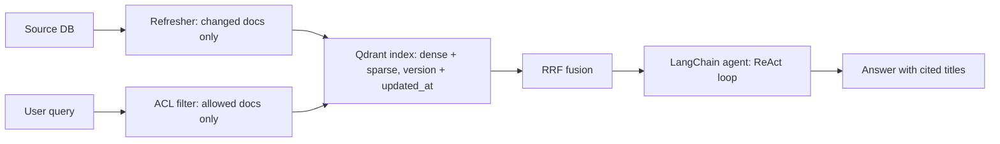

# Session 4: Production and Agentic RAG

Sessions 1 to 3 built search. Session 4 runs it. This session covers
what changes when real users, real docs, and real edits meet the
search you built: how docs get into the index, how edits reach it,
who may see what, how you know if a change helped, and how an agent
uses search as a tool.

The running example stays the same in every session:

- Doc 0: "How to reset your password"
- Doc 1: "VPN setup for remote work"
- Doc 2: "How to change your password"

Query A: "reset password". It shares exact words with Doc 0 and Doc 2.
Query B: "forgot my login". It means the same as Doc 0 and Doc 2, and
shares no useful words.

A second example appears where it helps: bathroom exhaust fans, from
a live class notebook. Query "quiet bathroom exhaust fan" and query
"revent 80 cfm", on the Amazon ESCI product dataset. The first query
is words a buyer types. The second is a brand and a spec. Lexical
search likes the second. Dense search likes the first. The same split
shows up in production: some queries are exact, some are meaning, and
the system must serve both.

## 1. The indexing pipeline

Search does not read your source database at query time. It reads an
index, which is a copy made for search. The pipeline that builds that
copy has five steps, in this order:

1. Source. The docs live in a source system, such as a docs site, a
   wiki, or a product catalog.
2. Chunk. Split each doc into pieces small enough to embed and to show
   as one result. A help page becomes a few chunks. A product becomes
   one chunk per product, with title, spec, and short text.
3. Embed dense and sparse. For each chunk, make a dense vector for
   meaning, and a sparse vector for exact words. In this course the
   sparse side is SPLADE style, from Session 3. In a real system the
   dense vector comes from an embedding model, and the sparse vector
   comes from a sparse model or from term weights.
4. Upsert to Qdrant. Send each chunk, with its vectors and its
   metadata, to Qdrant, a vector store. Upsert means insert if new,
   replace if the id already exists. The id is the key: same id, new
   content, and the old chunk is replaced.
5. Query. At search time, embed the query the same way, search Qdrant
   for dense and sparse matches, fuse the two lists with RRF, and
   return the top results.

Keep the order fixed. If you embed before you chunk, you embed the
wrong text. If you upsert before you embed, you have nothing to
search. Each step takes the output of the step before it.

Code reference: the toy version of this pipeline is the in-memory
index in `src/session04_production/refresh.py`. It stores docs by id
and replaces a doc when a new version arrives with the same id, which
is the same upsert idea in small form.

## 2. Incremental refresh

Docs change. A password page gets a new step. A fan product gets a
new price. The index must catch up, but rebuilding the whole index
for one changed doc wastes time and money. So refresh is
incremental: only changed docs go through the pipeline again.

Two triggers start a refresh:

- On push. The source system sends a change event when a doc is
  created, edited, or deleted. The refresher picks up that event and
  re-indexes that doc only.
- On a schedule. A refresher runs every few minutes, asks the source
  what changed since its last run, and re-indexes those docs only.

A delete is a refresh too. Remove the doc from the index, or a search
will keep returning a page that no longer exists.

Code reference: `refresh()` in
`src/session04_production/refresh.py` takes a list of changed docs
and upserts only those. Docs not in the list are left alone. The test
in `tests/test_session04_production.py` checks that an untouched doc
keeps its old version after a refresh of one other doc.

## 3. Eventual consistency and stale reads

An index is a copy, and a copy takes time to update. That gap has a
name: eventual consistency. The index will match the source
eventually, but not at once. A user who searches in the gap sees a
stale read: old content that is still in the index.

Worked example, with the running docs. Doc 0 is edited in the source
database at 10:00. The new version says to check email for a code.
The refresher runs at 10:05.

- At 10:02, a user searches "reset password". The refresher has not
  run yet. The index still holds version 1. The user sees the old
  steps.
- At 10:06, the same user searches again. The refresher ran at 10:05
  and upserted version 2. The user sees the new steps.

Nothing is broken. This is how the design works. The fix is not to
pretend the gap does not exist. The fix is to make the gap short,
visible, and safe.

Three habits make the gap safe:

- Version and timestamp on each doc. Store `version` and
  `updated_at` with every chunk in the index. Then a search result
  can show which copy it came from, and a debug session can tell at
  once whether the index or the source is behind. In the example
  above, version 1 has `updated_at` 09:00, and version 2 has
  `updated_at` 10:00.
- Cache invalidation. Search results are often cached, and a cache
  adds a second copy with its own gap. Two options keep it short.
  Use a short TTL, so a cached answer expires in seconds or minutes.
  Or purge the cache on refresh, so a doc refresh clears cached
  answers that used that doc. Pick one and write it down. A cache
  with no invalidation rule is a stale read that never ends.
- Read-your-writes for the author. The person who just edited a doc
  should see the new version at once. When the author searches, skip
  the cache, or read that doc from the source, or check the fresh
  index entry for that doc id. Other users can wait for the next
  refresh. The author cannot, or they will edit the same page twice
  thinking the first edit failed.

One more point about how data moves. The user gets data by pulling:
a new query runs against the index and pulls the current copy. The
system does not push new docs to the user. Push is the source telling
the refresher that a doc changed. Pull is the user asking the index
for an answer. Keep the two apart in your head, and the design stays
clear.

Code reference: `stale_read_demo()` in
`src/session04_production/refresh.py` runs the 10:00 to 10:06 story
in code. It indexes version 1, searches, refreshes with version 2,
and searches again.

## 4. ACL filter before search

Some docs are not for everyone. An internal runbook, a draft, or a
price list may be open to one group and closed to another. Access
control lists, or ACLs, say who may see each doc. Each doc carries a
list of principals, such as groups or roles. Each user carries the
principals they belong to. A doc is allowed when the two lists share
at least one principal.

The rule is simple: filter by permission before ranking, never rank
then hide.

Post-filtering, which means rank first and hide forbidden docs after,
fails in two ways:

- It loses recall. The top-k slots are fixed. When a forbidden doc
  takes a slot, an allowed doc below it never gets returned. The
  user sees fewer good results, or none at all.
- It leaks ranking scores. The ranker saw docs the user may not see.
  Scores, counts, or timing can leak facts about those docs, even if
  the titles are hidden.

Filter first, and the ranker never sees a forbidden doc. The top-k
slots go to allowed docs only.

Worked example. Two users, same query, "reset password". Doc 0 is
for eng only. Doc 2 is for support only. Doc 1 is for eng only.

- Ana is in eng. She may see Doc 0 and Doc 1. Her search returns
  Doc 0, "How to reset your password".
- Ben is in support. He may see Doc 2 only. His search returns
  Doc 2, "How to change your password". He never sees Doc 0.

Same query, different answers, and both are correct. The difference
is permission, not ranking.

Now the post-filter failure, with Ben and top-k of 1. Rank first:
Doc 0 ranks first, Doc 2 second. Take top 1: Doc 0. Hide it, because
Ben may not see it. Ben gets nothing. Filter first: Doc 0 is removed
before ranking, Doc 2 ranks first, Ben gets Doc 2. One lost slot is
the whole result when top-k is 1, and it still costs a good result
when top-k is larger.

Code reference: `filter_before_search()` and `search_after_filter()`
in `src/session04_production/acl.py` are the correct order.
`post_filter_wrong()` in the same file is the wrong order, kept so
the test can show the lost slot. `acl_example()` in the same file
runs the Ana and Ben example.

## 5. Caching

Caching is a trade: speed for freshness. A cached answer is fast,
and it is a copy of an answer, so it can go stale like the index.

Cache at two places, and know the cost of each:

- Query cache. Same query, same user, same permissions: return the
  last answer. This helps only for repeated queries, and the cache
  key must include the user or their principals. A cache key without
  permissions can serve Ana's answer to Ben, which breaks the ACL
  rule from the last section.
- Embedding cache. Same query text: reuse the query vector instead
  of calling the embedding model again. This is safe, because a
  vector for a query does not depend on who asked.

Invalidation, from Section 3, applies here too: short TTL, or purge
on refresh. A purge should clear query cache entries that used a
changed doc. If you cannot list which entries used that doc, use a
short TTL and accept a small gap.

## 6. A/B testing and CTR

You cannot tell if a change helped by looking at one search. You run
an A/B test: some users get A, some get B, and you compare a metric.

Setup, in order:

- A is BM25, the lexical ranker from Session 1. B is hybrid, the
  fused ranker from Session 3.
- Primary metric is CTR, click-through rate. Guardrails are latency
  and errors. If CTR rises but latency doubles, the change is not a
  clear win.
- Randomize by user ID hash. Hash the user id, and send even hashes
  to A and odd hashes to B, or the reverse. The same user always lands
  in the same arm, so they do not flip between A and B on each search.
- Decide sample size and duration before starting. Write down how
  many users and how many days the test needs. Do not stop early
  because the first day looks good.
- Check SRM, sample ratio mismatch, which means check the split is
  about 50/50. If A got 80 percent of users and B got 20 percent,
  assignment or logging is broken, and the result cannot be trusted.
- Do not peek. Checking the result each day and stopping when it
  looks good inflates false wins. Wait for the planned end, then read
  the result once.

CTR is clicks divided by impressions, times 100 for percent:

    CTR = clicks / impressions * 100

Worked example: 1000 searches, 120 clicks. CTR is 120 / 1000 * 100,
which is 12 percent. In code, `ctr()` in
`src/session04_production/ab_test.py` returns the fraction, 0.12,
and `ctr_percent()` returns 12.0.

SRM check, in plain numbers: 1000 users, 520 in A, 480 in B. The
expected count is 500 per arm. The difference is 20 in A and minus 20
in B. The shares are 0.52 and 0.48. A gap that size on 1000 users is
worth a look at assignment and logging, and it is not proof of a bug
by itself. A split of 800 and 200 is proof. Check the split before
you read CTR.

Code reference: `assign()` in
`src/session04_production/ab_test.py` hashes the user id with
`hashlib.sha256` and is stable for the same user. `srm_check()` in
the same file returns expected counts, observed counts, differences,
and shares in plain numbers.

## 7. LangChain agent wrapping hybrid search as a tool

RAG is retrieval plus generation. A retriever finds docs. A language
model writes the answer from those docs. An agent adds a loop: the
model can call tools, read what came back, and decide what to do
next. Hybrid search becomes one tool the agent can call.

The ReAct loop, from Yao et al. 2022, is the shape of that loop:
reason, act with a tool, observe the result, then reason again. In
short:

1. Thought. The model writes what it needs and what it will do.
   "The user asks how to reset a password. I need to search the docs
   before answering."
2. Action. The model calls the search tool with a query.
   `hybrid_search_tool("reset password")`.
3. Observation. The tool returns docs and titles. The model reads
   them.
4. Thought again. "The results match. I can answer from Doc 0." Or:
   "Nothing matched. I need a different query, or I must say so."
5. Re-search if needed. A second search with new words is allowed.
   A guess is not.
6. Final answer. Written from the observed docs only, with titles
   cited.

System prompt rules for the agent. These go in the system prompt, so
the model follows them on every turn:

- Always search before answering. No answer comes from memory alone.
- Never invent products, steps, or doc titles. If the tool did not
  return it, it does not go in the answer.
- Cite titles. Each claim points to the doc it came from, by title.
- Say honestly if nothing was found. "I could not find anything in
  the docs for that query" is a correct answer. A made-up answer is
  a failure.

LangChain snippet. This is a short sketch in the article only. It is
not run in tests. The runnable code in this session is the plain
function version in `src/session04_production/agent_tool.py`, with no
LLM and no network.

```python
from langchain_core.tools import tool

@tool
def hybrid_search_tool(query: str) -> str:
    """Search the docs. Use this before answering any doc question."""
    results = hybrid_search(query, top_k=3)  # your Session 3 ranker
    return "\n".join(f'{r["title"]}: {r["text"]}' for r in results)

# In a live agent, the model picks the tool call and writes the
# Thought lines. The tool above is the only way it reads the docs.
# Agent setup, such as create_react_agent with this tool and a
# system prompt holding the four rules above, is the next step once
# you have an LLM and a key. It is not part of this repo.
```

Why the sketch matters: the agent is only as honest as its tool.
If the tool filters by ACL first, the agent cannot leak a forbidden
doc. If the tool returns stale docs, the agent gives stale answers.
Production RAG is search plus a loop, and the loop inherits every
choice the search made.

Code reference: `hybrid_search_tool()` in
`src/session04_production/agent_tool.py` is the plain function
version, over the 3 toy docs, fusing lexical and dense ranks with
RRF. `answer_query()` in the same file calls the tool, formats an
answer that cites doc titles, and says honestly when nothing was
found. `react_loop_sketch()` in the same file runs the Thought,
Action, Observation loop once, with fixed steps and no LLM, so you
can read the shape of the loop without an API key. The file is
labelled as a sketch, not a live LangChain agent.

## The whole flow



Read it left to right. The source feeds the refresher. The refresher
keeps the index fresh. A query passes the ACL filter first, then
searches the index, then fuses the two rank lists. The agent calls
search as a tool, loops if needed, and writes the answer from what
the tool returned.

## Papers

- Lewis, Patrick, et al. 2020. "Retrieval-Augmented Generation for
  Knowledge-Intensive NLP Tasks". NeurIPS 2020.
  https://arxiv.org/abs/2005.11401
  The paper that named RAG. A model that retrieves passages from an
  external index and generates answers from them, instead of keeping
  all facts in its weights. The key idea for this session: the index
  is replaceable memory. Swap the index, and the answers change, with
  no retraining. That is why refresh and versioning matter.
- Yao, Shunyu, et al. 2022. "ReAct: Synergizing Reasoning and Acting
  in Language Models". ICLR 2023.
  https://arxiv.org/abs/2210.03629
  The paper behind the Thought, Action, Observation loop. A language
  model interleaves reasoning traces with tool calls, so it can check
  its plan against what a tool returns. The key idea for this
  session: an agent that searches, reads the result, and then decides
  what to do next, instead of answering from memory in one pass.

## Self-check questions

1. Doc 0 is edited at 10:00. The refresher runs at 10:05. A user
   searches at 10:02. Which version do they see, and why?
   Answer: Version 1, the old version. The index is a copy, and the
   refresher has not run yet, so the index still holds version 1.
   At 10:06 the same search returns version 2. This is eventual
   consistency: the index matches the source eventually, not at once.

2. Ben may see Doc 2 only. He searches "reset password" with top-k
   of 1. Post-filter returns nothing, and filter-first returns
   Doc 2. Why?
   Answer: Rank first puts Doc 0 first, because it matches both
   words. Top 1 keeps Doc 0 only. Hiding it after leaves nothing.
   Filter first removes Doc 0 before ranking, so Doc 2 takes the
   top slot. The lost slot is the cost of ranking before filtering.

3. An A/B test has 1000 searches and 120 clicks in arm B, and 1000
   searches and 90 clicks in arm A. What is the CTR of each arm,
   and what do you check before calling B the winner?
   Answer: B is 120 / 1000 * 100, which is 12 percent. A is
   90 / 1000 * 100, which is 9 percent. Before calling B the winner,
   check the SRM split is about 50/50, check latency and errors did
   not get worse, and check the test ran its planned duration and
   sample size, with no early stop from peeking.
